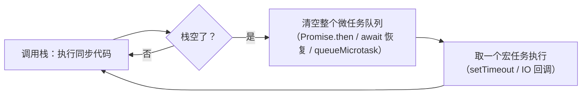

# JavaScript 极速地基（Java 视角）

> **学习目标**：用最短路径补齐"学 TypeScript 之前必须具备的 JavaScript 认知"，理解 JS 与 Java 在类型、`this`、对象、并发模型上的本质差异，能读懂并运行 JS 代码。
> **前置**：Java 基础（本目录全程用 Java 对照讲解）。
> **定位**：地基不是完整的 JS 教程——每个主题只讲到"不影响你学 TS"的深度，深水区在延伸方向里指路。

---

## 一、解决什么问题

TypeScript 官方教程的第一句前置要求就是 **"You'll need a working understanding of JavaScript"**。原因有两个，绕不过去：

1. **TS 的类型是对 JS 行为的标注**。`string | undefined`、`() => void`、`unknown`——这些类型描述的全是 JS 里值的行为。不懂"JS 的函数调用时 this 会变"，就看不懂 TS 为什么要给 `this` 参数单独设计语法。
2. **TS 编译产物就是 JS**。类型标注在编译时全部被擦除，跑起来的、报错的、被调试器断点的，都是纯 JS。`TypeError: Cannot read properties of undefined` 这类运行时报错，TS 一个字都帮不了你。

所以这一篇的目标很实际：**把 Java 程序员最容易栽跟头的 JS 差异点一次过一遍**，每个点都有可运行的证据。

## 二、核心原理：JS 与 Java 的运行模型对照

| 维度 | Java | JavaScript |
| --- | --- | --- |
| 类型检查 | 编译期（javac 挡住） | 运行时（写错类型当场不报错，用时才炸） |
| 变量与类型 | 变量有类型，终身不变 | 变量没类型，**值有类型**，`typeof` 查的是值 |
| 数字 | int/long/float/double 分家 | 只有 `number`（64 位浮点，无整型浮点之分） |
| 对象 | 先写 class 才能 new | 字面量直接造对象，属性可动态增删 |
| 方法与函数 | 方法属于类，不是值 | 函数是一等公民：可赋值、传参、当返回值 |
| `this` | 永远指向当前实例 | **由调用方式决定**：`obj.fn()` 是 obj，裸调用是 undefined |
| 并发 | 多线程 + 锁 | **单线程 + 事件循环**，没有抢占 |
| 模块 | package + import（只导类） | ESM 可导出任意值；不导出即私有 |
| 空值 | 只有 `null` | `null`（主动置空）+ `undefined`（从未赋值） |

表格里最反直觉的是最后三行的 `this`、并发、模块。`this` 在下文示例 02 展开，模块在示例 05/06 展开，先把**事件循环**的骨架立起来——它是 JS 并发模型的全部：



对照 Java：Java 里"边等数据库边处理请求"靠多线程；JS 里同一个效果靠"把等待的活交给运行时（Node 的 libuv / 浏览器），自己继续跑栈里的代码，等结果回来排个队，栈空了再处理"。**全程只有一个线程在执行你的代码**，所以没有竞态条件，也不需要锁——代价是任何一段同步代码卡住，整个程序都卡住。

## 三、示例逐段讲解

配套 [示例代码/](示例代码/)，共 6 个文件，全部可独立运行。

### 3.1 `01-变量与相等.js`：动态类型 + `===`

```js
let box = 42;          // number
box = 'hello';         // 换 string 也合法——类型跟着值走
box = { id: 1 };       // 再换 object：Java 里连编译都过不了
```

- `typeof box` 查的是**当前值**的类型，不是变量的类型（变量没有类型）。实测输出：`42 number` → `hello string` → `{ id: 1 } object`。
- `const` ≈ Java 的 `final`：锁的是"绑定"（不能重新赋值），不锁对象内容。
- `null` vs `undefined`：`let x;` 得到 `undefined`（系统说"没给过值"），`x = null` 是程序员主动置空。坑：`typeof null === 'object'`，1995 年的实现遗留，为兼容至今不能修。
- `===` 与 `==`：实测 `'5' == 5` 为 `true`（字符串隐式转数字）、`null == undefined` 为 `true`（特例：仅彼此宽松相等）、`NaN === NaN` 为 `false`（同 Java 的 `Double.NaN`）。**规约：一律用 `===`**，`==` 唯一合理用途是 `x == null` 一口气判双空。

### 3.2 `02-函数与this.js`：this 由"怎么调用"决定

Java 的 `this` 铁定指向当前实例；JS 的 `this` 是**调用时才确定**的，四条规则按优先级：

| 调用方式 | this 指向 | 示例 |
| --- | --- | --- |
| `obj.fn()` | obj | `user.greet()` → 小明 |
| 裸调用 `fn()` | undefined（严格模式） | 拆下来的方法直接调用 → 报错 |
| `fn.call(x)` / `fn.bind(x)` | 显式指定的 x | `detached.call(user)` → 小明 |
| 箭头函数 | **定义处外层**的 this（词法捕获） | 回调救星 |

实测名场面——方法拆下来再调用：

```text
你好，我是 小明          ← user.greet()
裸调用报错： Cannot read properties of undefined (reading 'name')   ← detached()
```

这就是"回调里 this 丢了"的根源：把 `user.greet` 传给 `setTimeout` / DOM 事件 / 数组方法当回调，本质都是"拆下来裸调用"。修复三选一：`call`（临时指定）、`bind`（永久绑定）、**箭头函数**（在定义处捕获 this，怎么拆都不丢）。

### 3.3 `03-对象数组与引用.js`：引用语义与浅拷贝

- 赋值传引用：`const b = a` 之后 `b.name = '被改了'`，`a.name` 实测也变（和 Java 对象引用一致，Java 程序员反而有优势）。
- `{ ...obj, price: 199 }` 是"拷贝 + 改字段"的惯用法（函数式更新状态的基石）。
- **浅拷贝的坑**：`{ ...original }` 只拷第一层，嵌套对象仍共享。实测改"拷贝"的 `info.stock`，原始跟着变 999；`structuredClone()` 才是彻底分离。
- `map/filter/reduce` 一一对应 Java Stream 的同名操作，链式写法几乎照搬；差别是 JS 数组方法**立即执行**，Java Stream 到终结操作才执行。

### 3.4 `04-异步与事件循环.js`：单线程的"并发"

一段代码 + 四个打印任务，实测完整输出（建议先自己推一遍再看）：

```text
A 同步：脚本顺序执行，立刻打印
B 同步：脚本本身没跑完，任何回调都插不进来
1 await 之前：同步执行
2 main() 调用后：await 让出控制权，脚本继续往下走
C 微任务：Promise 回调，优先于所有宏任务
3 await 之后：等价于 .then(res => ...) 回调里的代码
微任务 then1
4 main 完成的 Promise 商品7
微任务 then2（链式第二跳仍是微任务）
D 宏任务：setTimeout 0ms 也要等栈空 + 微任务清完
宏任务 timeout1
```

读法：`A B 1 2` 是同步栈（`await` 在 `1` 和 `3` 之间把控制权还给事件循环）；栈一空，微任务队列被**清空到底**（`C 3 then1 4 then2`），之后才轮到宏任务（`D timeout1`）。两个高频细节：

- `await` 之后剩下的代码 = `.then` 回调 = 微任务。async/await 只是 Promise 的语法糖。
- `4` 排在 `then2` 之前：队列先进先出，`then1` 完成时才把 `then2` 排到**队尾**，那时 `main` 完成回调已经排在前面了。

### 3.5 `05/06-工具库.mjs`：模块

- 导出三种形态：`export const` / `export function`（命名导出，导入时名字必须对上、用 `{}`）、`export default`（默认导出，一个模块只有一个，导入时名字随便起）。`import * as x` 命名空间导入 ≈ 把整个模块当一个静态工具类。
- 不导出的内容（`discountTable`）就是模块私有——ESM 靠"不导出"实现私有，对应 Java 的 `private`。
- 为什么是 `.mjs`：没有 `package.json` 的目录里 `.js` 默认按 CommonJS 解析，写 `import/export` 直接报错；`.mjs` 明确声明 ES 模块。CommonJS 与 ESM 并存是 Node 的历史包袱，TS 工程化（知识点 10）再讲怎么统一。
- 顺手踩的浮点坑：`50 * 1.13 = 56.49999999999999`，四舍五入得 **56** 不是 57（同 Java 的 double）。算钱先乘到整数分。

## 四、常见误区

| 误区 | 真相 | 一句话排查/纠正 |
| --- | --- | --- |
| "JS 是弱类型，没有类型" | 值有类型、变量没有；`typeof` 查值 | 打印前先 `console.log(typeof x)` |
| 用 `==` 图省事 | 隐式转换规则复杂（`'' == 0` 为 true） | 一律 `===`，判空用 `x == null` |
| null 和 undefined 随便用 | 语义不同：主动置空 vs 从未赋值 | 自己置空用 null；看到 undefined 先想"是不是忘了赋值/拼错了属性名" |
| 回调里的 this"玄学丢失" | 拆下来裸调用 → this = undefined | 回调一律箭头函数，或 `bind` |
| `{...obj}` 拷贝就安全了 | 浅拷贝，嵌套对象仍共享 | 嵌套可变就用 `structuredClone` |
| "await 会开新线程" | 单线程，await 只是让出控制权 | 同步代码里的死循环，await 救不了 |
| `var` 和 `let` 差不多 | var 函数作用域 + 提升 + 可重复声明 | 新代码一律 `let/const`，var 只在读老代码时认识 |
| `.js` 里直接写 import | 默认 CommonJS 环境会报错 | 换 `.mjs` 或配 `package.json` 的 `type: module` |

**排查思路**：JS 报错先看第一行——`TypeError: Cannot read properties of undefined (reading 'x')` 九成是"对象本身是 undefined"（属性拼错 / 忘赋值 / this 丢失），顺着这一行往上是哪个变量、怎么来的，`console.log` 打点看值。

## 五、八股追问

前端面试对这些 JS 基础同样穷追猛打，按"结论 → 为什么 → 常见追问"整理：

**1. JS 是单线程的，为什么还能异步/并发？**
结论：等待型任务（IO、定时器、网络）交给运行时，JS 线程只执行回调；靠事件循环轮转，同一时刻仍只有一段代码在跑。
为什么：浏览器要操作 DOM，多线程同时改 DOM 需要锁，代价大于收益；而大部分"慢"其实是等 IO，不需要 CPU 并行。
常见追问：计算密集型怎么办（Worker 线程/子进程，真并行但不共享 DOM）？同步死循环会怎样（整个页面/服务卡死，事件循环停转）？

**2. 宏任务和微任务的区别？**
结论：来源不同（setTimeout/IO 回调 vs Promise.then/await 恢复/queueMicrotask）；每轮宏任务前，微任务队列**清空到底**才轮到下一个宏任务。
为什么：微任务设计初衷是"当前这轮同步收尾前必须完成的收尾工作"（如 Promise 状态一致），优先级天然更高。
常见追问：`await` 之后的代码属于哪个（微任务）；`setTimeout(fn, 0)` 真的 0ms 吗（至少 1ms，嵌套 5 层后被钳到 4ms）；`process.nextTick`（Node 专属，优先级比微任务还高）。

**3. `==` 的隐式转换规则？**
结论：同类型直接比；`null` 与 `undefined` 仅彼此相等；布尔先转数字；数字遇字符串，字符串转数字；对象遇原始值，对象先 `valueOf/toString` 转原始值。
为什么：历史设计追平"方便"，规则表庞大难记。
常见追问：`[] == false` 为什么是 true（`[]` → `''` → `0`，`false` → `0`）；为什么团队规约禁用 `==`（语义不可预测，`===` 心智成本为零）。

**4. null 和 undefined 的区别？**
结论：undefined = "从未赋值/不存在"（系统口径），null = "故意置空"（程序员口径）。
常见追问：`typeof null` 为什么是 'object'（历史 bug 不能修）；函数无 return 返回什么（undefined）；参数没传是什么（undefined，可用默认参数兜底）。

**5. let / const / var 的区别？**
结论：let/const 块级作用域、不挂到全局对象、有暂时性死区；const 锁绑定不可重新赋值；var 函数作用域 + 提升 + 允许重复声明。
常见追问：const 对象的属性能改吗（能，const 锁的是变量指向，不锁对象内容，类比 Java final 引用）；暂时性死区是什么（声明语句执行前访问报 ReferenceError，而 var 是 undefined）。

**6. 箭头函数和普通函数的区别？**
结论：箭头函数没有自己的 this/arguments，this 词法捕获定义处外层；不能当构造函数 new。
为什么：解决回调里 this 丢失，替代"var self = this"老写法。
常见追问：对象方法能用箭头函数吗（不能——捕获的是模块/外层 this，不是对象）；什么时候必须用普通函数（需要动态 this：DOM 事件、对象方法、构造函数、原型方法）。

**7. Promise 的三态？链式怎么传？**
结论：pending → fulfilled 或 rejected，**不可逆**；`.then` 传值、`.catch` 兜错、`.finally` 收尾；async/await 是同一套东西的语法糖。
常见追问：catch 之后还能 then 吗（能，catch 正常返回就回到 fulfilled 轨道）；一个 Promise 挂多个 then 会都执行吗（会，多路广播）。

**8. JS 是解释型还是编译型？**
结论：现代引擎（V8）是**即时编译（JIT）**：先快速生成字节码跑，热点代码再编译成机器码。
为什么：纯解释慢，纯编译（像 Java 先编译后运行）启动慢；JIT 折中。
常见追问：和 javac 的区别（javac 提前把整个程序编译成字节码 + 运行时 JIT；JS 没有"编译产物必须先存在"的阶段，类型检查更是 TS 后来外挂的）。

## 六、实际应用

这些地基在后续 TS 与前端开发里的出场位置：

- **事件循环**：浏览器里所有请求/事件/渲染都走它；前端"页面卡死"九成是同步代码阻塞了事件循环（后端的"慢 SQL 卡接口"在 JS 世界变成"慢同步代码卡全世界"）。
- **箭头函数**：Vue3/React 的回调、数组方法、定时器里到处都是，选择依据只有一条——要不要捕获外层 this。
- **引用语义与浅拷贝**：框架里"不可变更新状态"（`{ ...state, x: 1 }`）的根基；改了嵌套对象界面不刷新，九成是浅拷贝共享了旧引用。
- **`===` 与空值**：TS 的可空类型 `string | undefined` 就是把这两个 JS 概念类型化，看不懂 undefined 就看不懂 TS 的空值防线。

## 七、延伸方向

- **闭包**：函数记住定义处的变量——JS 模块化与无数设计模式的底层机制（下一个知识点 `初识 TypeScript` 的示例会顺路用到）。
- **原型链与 class**：JS 的"类"是原型继承的语法糖，与 Java 类有本质差别（TS 知识点 8 展开）。
- **DOM 与浏览器**：事件、渲染、请求——真正的"前端"从这里开始（TS 主线之后的下一个模块）。
- **Node 事件循环的阶段模型**：timers/poll/check 等阶段比浏览器的两级队列更细，做 Node 服务端时再深入。

## 八、运行示例

环境：Node 18+（本机实测 Node 18.20.4）。在 `示例代码/` 目录下：

```powershell
node 04-异步与事件循环.js
```

预期输出即 3.4 节的完整 11 行（同步 4 行 → 微任务 5 行 → 宏任务 2 行）。再试：

```powershell
node 02-函数与this.js
```

第 4 行输出为真实报错信息 `裸调用报错： Cannot read properties of undefined (reading 'name')`——它是被 `try/catch` 接住的，去掉 try/catch 再跑，进程会直接崩在同一句话上。全部 6 个文件可 `powershell -ExecutionPolicy Bypass -File .\运行全部.ps1` 一键跑完。
