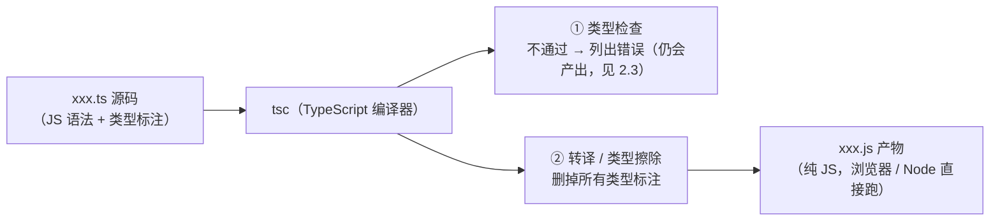

# 初识 TypeScript

> **学习目标**：理解 TypeScript 与 JavaScript 的确切关系（超集、类型擦除），亲手完成第一次 `tsc` 编译，看懂 tsc 报错的格式与错误码，建立"类型检查只在编译期"的心智模型，认识 `any` 的传染性。
> **前置**：[JavaScript 极速地基](../JavaScript极速地基/知识详解.md)（本文所有运行时行为都是 JS 行为）。
> **环境**：Node 18+；编译器用 `npx -p typescript@5 tsc` 免安装（本机实测 5.9.3）。

---

## 一、解决什么问题

JS 的大型工程有三痛，全部源于"类型检查发生在运行时"：

1. **拼错静默通过**：`order.amout`（少了 n）在 JS 里不报错，拿到 `undefined`，直到很远的地方才炸——示例 02 的错误 2 就是它。
2. **重构不敢动**：改一个函数签名，调用方全靠全文搜索；漏一处就是线上事故。
3. **文档永远过期**：函数要什么参数、返回什么，注释写了没人看、改了没人更新。

TypeScript 的答案：**在 JS 之上加一层"编译期类型检查"，检查完把类型全部擦掉，输出纯 JS**。javac 之于 Java 的第一道防线（编译期拦住类型错误），TS 补给了 JS。三个痛点对应变成：拼错当场红线、重构改完签名编辑器列出所有受影响调用处、类型即文档（跟着代码走，永不过期）。

一句话定位：**TS = JS + 编译期类型检查**。它是 JS 的严格超集：任何合法 JS 代码都是合法 TS 代码；TS 额外多出的部分（类型标注、接口、泛型……）只用于检查，不进入运行时。

## 二、核心原理

### 2.1 tsc 做的两件事



对照 Java：`javac` 把 `.java` 编译成字节码（类型信息保留在字节码里，运行时 JVM 还能用）；`tsc` 把 `.ts` 编译成 JS 时**把类型全部扔掉**——运行时不存在任何类型信息。这个差别叫**类型擦除（type erasure）**，它决定了 TS 的能力边界（见 2.4）。

### 2.2 类型标注的三个位置

```ts
const price: number = 299;                        // 变量：类型写在名字后面（Java 在前面）
function withTax(amount: number, rate: number): number { ... }   // 参数 + 返回值
type Product = { id: number; name: string };      // 自定义形状（知识点 ③ 细讲）
```

不是每处都要写：`const derived = 3.14` 会自动**推导**为 `number`。实践中"能推导的不写、函数边界（参数/返回值）必须写"，知识点 ⑤ 专门讲推导规则。

### 2.3 报错了还产出吗？

**默认产出**（`noEmitOnError: false`）。实测 `npx tsc` 列出 6 个错误、exit code 2，但 `.js` 照常生成。所以"编译报错"要当成**红灯**处理——产物能跑不代表没错，示例 02 里四个错误三个静默出错值、一个当场崩溃。

两个常用开关：`--noEmit` 只检查不产出（CI、编辑器体检）；`noEmitOnError: true` 报错不出产物（严格流水线）。

### 2.4 能力边界：类型检查只在编译期

TS 挡得住"编译期能证明"的错；挡不住运行时才知道的错：

```ts
const config: any = JSON.parse('{"port":3306}');  // 外部数据，TS 看不见内容
const portText: string = config.port;             // any 放行：3306（number）被当 string
```

实测运行产物输出 `3307`——`: string` 标注形同虚设。**类型是"标注"，不是"保证"**；外部输入（JSON、用户输入、接口返回）需要运行时校验（Zod 等库，实战知识点再展开）。

### 2.5 any：逃生舱，也是破洞

- **显式 any**：`const x: any = ...` 关闭对 x 的一切检查，且**传染**——用它算出的值还是 any，一路放行（示例 03 的连锁）。
- **隐式 any**：参数不标类型，strict 模式直接报 `TS7006`，逼你表态。
- `unknown` 是 any 的安全版（不能用直到收窄），知识点 ③/④ 展开。

## 三、示例逐段讲解

配套 [示例代码/](示例代码/)，三个 `.ts` + `tsconfig.json`，以下输出均为本机实测。

### 3.1 `01-类型标注与类型擦除.ts`：标注长什么样，擦除擦掉了什么

`npx -p typescript@5 tsc --target ES2020 01-类型标注与类型擦除.ts` 后对比源码与产物：

```text
源码                                          产物（.js）
const productName: string = '机械键盘';   →   const productName = '机械键盘';
function withTax(amount: number, ...        →   function withTax(amount, rate) {
  rate: number): number {                        return amount * (1 + rate);
  return amount * (1 + rate);                }
}
type Product = { id: number; ... };        →   （整段消失）
```

`: 类型` 全部消失，`type` 定义整段消失，其余一字不差。产物运行输出：

```text
机械键盘 [ '外设', '办公' ] 含税价 337.86999999999995
{ id: 1, name: '机械键盘', price: 299 }
```

（337.869… 又是二进制浮点：`299 * 1.13`。Java 的 double 同款行为。）

### 3.2 `02-编译期拦截.ts`：四类错误、两种下场

`npx tsc`（读 tsconfig，strict 开启）实测输出：

```text
02-编译期拦截.ts(14,7): error TS2322: Type 'number' is not assignable to type 'string'.
02-编译期拦截.ts(18,36): error TS2551: Property 'amout' does not exist on type '{ id: number; amount: number; }'. Did you mean 'amount'?
02-编译期拦截.ts(22,22): error TS2554: Expected 2 arguments, but got 1.
02-编译期拦截.ts(30,32): error TS2551: Property 'toUppercase2' does not exist on type '"hello"'. Did you mean 'toUpperCase'?
03-any的连锁反应.ts(15,17): error TS7006: Parameter 'who' implicitly has an 'any' type.
03-any的连锁反应.ts(25,20): error TS2345: Argument of type 'number' is not assignable to parameter of type 'string'.
```

读报错三段式：**文件(行,列) → 错误码 → 人话描述**。高频错误码背下来：`TS2322` 类型不匹配（最常撞）、`TS2339/TS2551` 属性不存在（2551 会附"Did you mean"纠正建议）、`TS2554` 参数个数、`TS2345` 参数类型、`TS7006` 隐式 any。有没有很眼熟？`Did you mean 'amount'?` 就是 javac "cannot find symbol / Did you mean..." 的 TS 版。

再跑产物 `node 02-编译期拦截.js`，四个错误的运行时下联盟：

| 错误 | 产物运行时表现 | 危险度 |
| --- | --- | --- |
| 1 类型不匹配 | 输出 `112.99999999999999`，无感 | 静默错值 |
| 2 属性拼错 | 输出 `undefined` | 静默错值（最阴险） |
| 3 参数少传 | 输出 `NaN` | 静默错值 |
| 4 调用不存在的方法 | `TypeError: "hello".toUppercase2 is not a function`，进程崩溃（exit 1） | 当场爆炸 |

结论：**编译期错误 ≠ 运行时必炸**——更多错误在运行时"悄悄地错"，这正是必须在编译期修掉它们的理由。

### 3.3 `03-any的连锁反应.ts`：一个 any，全线失守

三步连锁：`JSON.parse` 返回 any → `config.prt`（拼错）不报错，运行时输出 `undefined` → `const portText: string = config.port` 放行（number 塞进 string 标注）→ `portText + 1` 实测输出 `3307`。对照标好类型的 `greet3(42)`，tsc 立刻报 `TS2345`——同一类问题，标注就是防线，any 就是拆防线。

## 四、常见误区

| 误区 | 真相 | 一句话纠正 |
| --- | --- | --- |
| "TS 能在运行时挡住类型错误" | 类型擦除后运行时零类型信息 | TS = 编译期防线；运行时校验要靠代码/校验库 |
| "tsc 报错就没产物，不用管" | 默认照样产出 `.js` | 报错当红灯：CI 用 `--noEmit` + exit code 把关 |
| "interface/type 编译后还在" | 全部擦除（enum、namespace 例外，有运行时产物） | 想要运行时存在的结构用 class/enum/对象常量 |
| "any 也是类型，标了就行" | any = 关闭检查，且传染下游 | 外部数据先用 unknown，收窄后再用（后续知识点） |
| "JS 项目要先把代码全改完才能上 TS" | TS 是超集，`.js` 原样合法；可逐文件改名渐进迁移 | 建新工程直接全 TS，老工程 allowJs 混编过渡 |
| "TS 是另一门语言，学的 JS 白学了" | TS 的运行时就是 JS | 地基知识全部直接复用 |

**排查思路**：看到 tsc 报错先读三段式（文件/行/列 → 错误码 → 描述），错误码 TS2322/2345 沿"声明的类型 ← 实际的值"两头对；TS2551/2339 直接看 Did you mean 建议，九成是拼错或用错对象。

## 五、八股追问

**1. TypeScript 和 JavaScript 是什么关系？**
结论：TS 是 JS 的**超集 + 编译期类型检查器**；任何合法 JS 都是合法 TS；类型标注编译时全部擦除，产物是纯 JS。
为什么这么设计：替换成本为零（存量 JS 代码可直接进 TS 工程），又能拿到静态检查的收益。
常见追问：TS 是独立语言吗（语法上超集，运行时不存在 TS——没有"TS 引擎"）；浏览器认识 .ts 吗（不认识，必须先编译）；TS 会拖慢运行时吗（不会，产物就是等价 JS）。

**2. 什么是类型擦除？哪些东西会被擦掉？**
结论：编译时删除所有类型标注——`interface`、`type`、泛型、类型别名、`as` 断言全部消失；产物里只剩运行时需要的代码。
为什么：类型只服务于编译期检查，运行时（JS 引擎）没有类型系统的概念。
常见追问：enum 为什么不消失（enum 有运行时行为——生成真实的对象，所以保留；`const enum` 才内联擦除）；怎么验证（对比 .ts 和产物 .js，示例 01 已做）；产物里想保留类型信息怎么办（sourcemap 保留的是位置，不是类型检查）。

**3. tsc 报错了为什么还能跑？**
结论：默认 `noEmitOnError: false`，报错仍产出；产物能不能跑取决于错误是否在运行时才触发。
为什么这么默认：渐进迁移——老工程改一个文件不该导致全站编不出产物。
常见追问：怎么改成不出（tsconfig `noEmitOnError: true` 或 CI 里 `tsc --noEmit` 检查 exit code）；exit code 是什么（0 通过，2 有类型错误——可用于脚本把关）。

**4. any 的危害是什么？和 unknown 什么区别？**
结论：any 关闭检查且传染（用它算出来的还是 any）；unknown 也表示"任意值"但**不可用**，必须先收窄（typeof/断言），是 any 的安全替代。
为什么：any 本质是"检查器，请你闭嘴"；unknown 是"我不知道，但你用之前得先证明"。
常见追问：隐式 any 报什么（TS7006，strict 下 noImplicitAny 开启）；`as` 断言和 any 的关系（断言是"我向检查器担保"，滥用同样危险）。

**5. TS 的类型检查发生在什么阶段？和 Java 比缺了什么？**
结论：只在编译期（tsc）；Java 除了编译期检查，运行时还有字节码验证器、instanceof、ClassCastException 兜底。
为什么：TS 编译到 JS 就丢类型，运行时没有类型可查。
常见追问：那外部数据怎么办（运行时校验：手写守卫函数或 Zod 类库）；`instanceof` 在 TS 里能用吗（能，它是 JS 运行时操作，还兼作类型收窄，知识点 ③ 讲）。

## 六、实际应用

- **新项目默认 TS**：Vue3 / React / Node（NestJS）官方脚手架全部默认 TS；招聘 JD 里"会 TS"已是前端标配。
- **编辑器体验**：VSCode 的 TS 语言服务就是 tsc 同款引擎——悬停显示类型、自动补全、红线报错，全靠类型检查器驱动；写 TS = 给自己的编辑器"喂数据"。
- **老项目渐进迁移**：`allowJs: true` 允许 .js/.ts 混编，按文件逐个改名迁移（知识点 ⑨ 声明文件、⑩ 工程化展开）。
- **和后端的配合**：接口返回值标好类型，前后端字段对不齐在编译期就暴露（对照 Java 里 DTO 的作用）。

## 七、延伸方向

- **基础类型与收窄**（知识点 ③）：string/number 之外，联合类型、字面量类型、判别联合才是 TS 表达力的来源。
- **类型推导**（知识点 ⑤）：什么时候不用写标注、`as const`、`satisfies`。
- **运行时校验**（实战知识点加餐）：Zod——"一次声明，编译期+运行时双重校验"。
- **TS Playground**（[typescriptlang.org/play](https://www.typescriptlang.org/play)）：在线 .ts，实时看产物与报错，适合随手验证。

## 八、运行示例

环境：Node 18+（本机 18.20.4）、`npx -p typescript@5 tsc`（实测 5.9.3）。在 `示例代码/` 目录：

```powershell
npx -p typescript@5 tsc --target ES2020 01-类型标注与类型擦除.ts   # 第 1 步：看类型擦除
npx -p typescript@5 tsc                                            # 第 2 步：6 个错误（预期）
node 02-编译期拦截.js                                               # 第 3 步：3 行错值 + 1 次崩溃
```

第 3 步实测输出（节选）：

```text
错误1 的产物值 label2 = 112.99999999999999
错误2 的产物值 amountCopy2 = undefined
错误3 的产物值 bad2 = NaN
TypeError: "hello".toUppercase2 is not a function
```

完整命令与逐条说明见 [示例代码/README.md](示例代码/README.md)。
